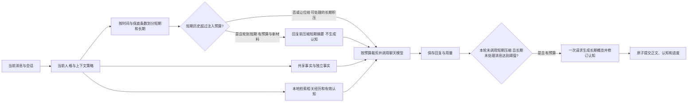

# WhaleLife 记忆系统

核对日期：2026-11-08。

本文说明已经实现的记忆架构、认知修订和插件边界，可用于开发交接与开源介绍。示例均为虚构数据，不包含本机配置或真实记忆。渠道接入见 [CHANNELS.md](CHANNELS.md)。

主干整体能力、实际调用链和统一问题表见 [STATUS.md](STATUS.md)。本文维护记忆的细节规则，不另维护主干待办；下文的预算管理仅指核心记忆整理和上下文预算，不管理插件额度。

统一会话队列只保存内存中的待执行请求，不属于记忆。等待、去重和执行前取消不会生成对话/经历或消耗模型token；真正执行时读取最新有效上下文，普通消息保留入队前的主干接收时间及来源。enqueueTransient沿用临时输入不落盘规则，工具结果与最终回复默认照常记录，显式临时工具按下述规则处理；等待项也阻止会话删除/记忆恢复等冲突操作。接口和容量/取消语义见[插件规范](PLUGINS.md#统一会话队列)。

聊天是主要记忆，工具执行过程是工作记录。普通Web/渠道聊天及sessions.run/ enqueue保留用户输入和最终助手正文，包括提问、约定和实际讲给用户的引用；调用临时工具不再把整条回复替换成占位文字。工具原始资料仍只供本轮执行，registerTransient的content不自动落盘，后续工具参数和检索query继续隔离，独立事实写入仍受保护。渠道保存最终聊天正文，显式重试只重投递，不重跑模型或工具。

工具自动投影标记为tool_trace，仅供审计，不进入日常记忆列表、检索、共享空间召回或后续上下文。真实业务结果继续通过已有recordExperience保存短经历；工具调用返回不代表业务成功，主干不解释插件的私有回执字段。已在聊天中表达的结果不再自动复制成一份可召回的工具过程。后台动作没有对应聊天时，插件仍应记录有依据的结果、来源及outcome。

执行档案独立保存在`logs/executions/<sessionId>/<executionId>.jsonl`，不在记忆目录，不参与检索、共享、摘要、认知或自动上下文组装。模型遇到异常、需要核对旧动作时可以自行调用只读工具`inspect_execution`，无需用户先问；只读取当前会话的选定分页。读取结果使用临时工具契约，仅留在当前任务上下文，下一次聊天不携带；最终对用户说出的排查结论属于正常对话。档案不会额外调用模型总结。记录内容和隐私边界见[插件规范的执行档案](PLUGINS.md#执行轮次与按需排查档案)。

旧工具自动投影只有与原始工具档案的来源、结果及完整投影文本相匹配才退出召回，不按关键词批量删记忆；无法匹配的旧记录保留。旧的临时占位消息从对话上下文和召回中排除，但原始档案不改写，已经没有保存的回复无法还原。显式runTransient/enqueueTransient属于插件技术执行，其临时输入不变；若该执行又使用临时工具，最终正文仍不自动成为聊天记忆，按既有契约留审计标记及用量。插件显式写文件或发送内容仍须负责真实结果和保存边界。字段和限制见[临时工具契约](PLUGINS.md#临时工具内容与持久回执)。

## 设计目标

WhaleLife 将会话视为持续存在的记忆空间。人格决定当前如何回应，会话保存共同经历；切换人格不创建新会话。不同会话默认独立，原有共享事实继续可用，跨会话分享必须显式选择。

核心提供经历、事实、认知、摘要、检索和预算管理。插件可以扩展业务记忆，但意图与自主行动属于未来的主动性插件：安装一个能力不等于已经使用它，也不等于核心会主动执行它。

意图文件由主干通过通用会话文档接口托管；内容结构、产生、注入、唤醒、执行及结束处理均归自主性插件。没有自主性插件就不产生意图，也没有额外的主干意图工具或提示词。普通自主行动不以已有意图为前提。

磁盘可以保留完整档案，模型只看到必要片段。增加历史版本不会自动增加每轮输入；额外费用来自实际发送的内容和整理请求，而非文件夹数量。

插件可用sessions.runTransient提供仅本轮有效的技术说明。输入及该轮检索query不落入记忆；真实决定和动作结果仍由recordExperience记录，普通会话不变。旧输入可通过excludeInputs按所属插件的精确消息ID排除，原文留作档案；详见PLUGINS.md的迁移契约。模型历史与摘要读取过滤排除标记，旧摘要和自动认知失效后从有效原文重建，不通过正文替换猜测内容。

模型协议的reasoning_content仅在当前工具链内传递，不追加为经历、事实或认知，不写入未来历史。需要该协议的思考工具模型读取已完成历史时，以带原发言角色和来源的引用形式提供，保留现有窗口内的正文，不伪造缺失的旧思考字段。临时输入的wire角色用于开启新轮次，不是“真人发言”的存储标记。详见PLUGINS.md。

默认记忆列表合并当前会话与显式共享来源后，按记录时间ts从新到旧统一排序，再取100条。相同时间按session、id字典序稳定排序；缺失/无效时间放在有时间记录之后，同样按session、id排序，不用事件发生时间occurred_at替代ts。关键词查询仍按相关性排序；排序不改写原始内容。

## 内容与存储

| 内容 | 用途 | 写入边界 |
| --- | --- | --- |
| 原始经历 | 记录说过什么、做过什么、执行结果及来源 | 追加保存，不因摘要、修订或淡忘改写原文 |
| 共享事实 | 用户维护的共同资料 | AI 只读 |
| 独立事实 | 当前会话的少量稳定资料 | AI 可追加、替换或清空，整份正文硬上限 100 个 Unicode 码点 |
| 短期摘要 | 在历史预算不足时压缩短期交流 | 最多 200 个 Unicode 码点，只压缩上下文，不提炼认知 |
| 长期概览 | 概括已进入长期范围的旧交流 | 最多 200 个 Unicode 码点，与长期处理进度共同提交 |
| 认知 | 根据长期经历形成的理解或判断 | 每批最多 2 条，每条最多 80 个 Unicode 码点；保留证据、人格版本及不确定性 |
| 插件扩展 | 插件私有状态及可检索的简短描述 | 按所属插件隔离、注册类型后使用 |
| 会话文档 | 插件自行解释的 JSON 文件，例如意图文件 | 公开接口读写，不参与召回、摘要或自动上下文注入 |

独立事实是常驻背景，不是待办或持续行动指令。主干提示模型优先保留称呼、长期偏好等稳定资料，一次活动和当日安排留在普通经历中；已有临时信息只描述记录当时的情况，不能因为没有更新就推断尚未完成。只在相关时使用，没有新信息或新约定不因同一事实反复询问、确认或催促，尊重用户不想被提醒的意愿。此处是提示词引导，不是提醒频率调度或强制语义过滤；不自动删除既有事实、不阻止用户明确保留内容，100字符限制和插件接口保持不变。

100 字限制只适用于独立事实整份正文，不是每条记录 100 字，也不是全部会话记忆只能有 100 字。空格、标点、换行均计数；后端写入、并发合计和备份恢复都校验。`full` 工具权限不能绕过这条规则，也不能让 AI 修改共享事实。独立事实保存最近 20 个历史版本。

```text
memory/
  facts.md                           用户维护的共享事实
  index.json                         当前会话选择、会话索引、摘要归属与删除墓碑
  sessions/<session-id>/
    session.json                     会话元数据的展示副本
    episodes/YYYY-MM.jsonl           分段原始流水，包含稳定事件 ID
    episodes/legacy.jsonl            迁移的旧流水（存在时）
    knowledge/state.json             独立事实、认知、整理进度、预算和用量
    summaries/<summary-id>.md         摘要展示副本
    extensions/<owner-hash>/*.json    按需创建的插件私有数据
    extensions/<owner-hash>/documents/<key>.json  不参与检索的会话文档；intents 是插件可选的文件名
  shared/spaces.json                  显式共享空间与记录引用
  trash/                             删除会话后的可恢复档案
```

`index.json` 是会话元数据的读取依据；`knowledge/state.json` 中的摘要正文及进度是整理的提交依据。短期与长期分别保存检查点，`mode` 为 `short` / `long`；短期使用 `s_` 摘要键，长期保留旧 `p_` 键以兼容既有数据。展示副本不是第二份独立事实源。旧数据启动迁移前先完整备份并校验；已有会话 ID 不变。已有 500 字摘要与 150 字认知不立即改写，旧概览注入模型时裁到 200 字，后续有效输出才按新上限更新。

短期时间窗口起点改变时，旧摘要不能再当作当前短期上下文注入；重建失败保留最后一次成功正文及覆盖进度，只更新失败、重试和尝试顺序等元数据，不用空检查点覆盖成功结果。来源排除版本也随重建保留，不能重新带回已排除的技术输入。控制台以状态文件为准区分有效、失败、待重建和历史范围；已知状态没有正文时不退回旧展示副本，无状态的旧版文件仍可作为历史资料查看。

## 时间上下文

主干配置 `timezone` 默认 `Asia/Shanghai`。控制台暂时隐藏时区编辑入口，“使用配置 → 时间与日期”仅显示当前时间，保留已有配置及其保存兼容性。状态页接口返回主干系统时钟的时间、星期、时区及UTC偏移；显示的是读取时的快照，不调用外部授时服务。

完整会话链路每次请求模型都附加一行当前时间、本条消息时间和距本会话上次交流的间隔，包括工具执行后的继续请求。交流间隔仅使用当前历史权限可见的对话消息，不计工具、回执和后台整理；历史关闭或时间缺失时标记未知，未来时间标记异常。直接 `llm.chat` 及非对话模型接口保持原样。

新消息的 `ts` 保持UTC格式，同时保存当轮 `timezone`。历史输入按同一分钟、同来源合并标签，裁剪后首条恢复标签；模型输入预算计入标签和时间提示。修改工作空间时区不改变旧消息的原时区。旧记录缺少原时区时只作当前时区换算，并明确标注缺失，不猜相对日期。

记录时间与事情发生时间分开：插件 `recordExperience` 可选传入 `occurred_at`（必须是带时区的有效ISO时间，保存为UTC）；`ts`仍为主干实际记录时间。事件时间只作资料，不覆盖主干时钟，也不改变原有短长期划分或召回衰减规则。

短期压缩、长期提炼都接收原消息时间及对应当地时间，并要求将有依据的“明天”等约定整理成明确日期；无依据则保留不确定性。摘要保存核心计算的 `time_range`（来源记录时间范围及缺失标记），认知按证据记录派生范围，模型不能伪造。旧摘要不追溯改写，缺少日期依据时明确标注。日期理解仍由模型完成，元数据和长度上限由代码保证。

时间信息不写入100字独立事实，不增加额外模型请求；摘要仍最多200字、认知每条80字。动态时钟位于稳定系统提示之后，每轮仅替换这部分，原始对话文本保留。测试见 `tests/time-context.test.ts`。

## 短期与长期的分界

默认短期时间窗口为 7 天，至少保留最近 100 条消息。只有同时满足“早于 7 天”且“超出最近 100 条”的消息才进入长期范围。100 条是保底，不是上限：一个月只聊 20 条时全部仍属短期；一天聊 300 条也全部属短期。原始记录始终保留，进入长期范围不等于删除或立即生成认知。

`history_enabled` 控制是否带入历史，`include_summary` 控制短期摘要生成与使用，`long_term_enabled` 控制后续长期认知整理。这三个开关独立保存；关闭长期整理不删除已有认知或阻止检索，带入历史时仍可使用已有长期概览。`short_term_days` 可设为 1–3650，`short_term_min_messages` 可设为 1–10000。`budget_tokens` 仍是用户设置的历史注入预算（示例配置为 6000），不代表模型上下文窗口，也不决定消息何时进入长期范围。

旧 `recent_lines=0` 迁移为不带入历史；正数不再构成消息数量上限，旧默认 30 条也不保留该限制。旧 `include_summary=false` 在没有显式长期设置时迁移为关闭长期整理；新设置允许单独启停短期与长期。

## 一轮对话如何使用记忆



默认 `history_scope=session`，同一会话内不同人格共用历史和摘要。显式选择 `persona` 时，只使用当前人格版本对应的近期历史与摘要，认知候选也按该范围筛选。独立事实仍属于会话，不属于人格。

本地检索使用中文分词、少量别名、词稀有度和鲜活度排序；普通自动召回最多 6 条，默认约 800 估算 token。只截取相关原文附近片段，不把整个目录或所有历史版本发给模型。模型可使用 `recall_memory` 主动查找旧事，但仍受范围与结果预算限制。

普通经历默认按 30 天半衰期降低召回排序，不物理删除。置顶可以抵抗时间降权；明确追问历史时不使用时间降权。相关性不足时返回空结果。Embedding 配置与接口测试已存在，但当前记忆检索不调用 Embedding。

## 认知的修订、合并与复核

例如，旧认知为“用户居住南京”，新经历明确说明“已经搬到北京”。当新经历进入长期范围并达到整理条件时，核心取出相关旧认知，允许模型产生“用户居住北京”，同时引用新经历并指定替代的旧认知。旧记录保留原文和原证据，退出普通召回；短期压缩不会触发这种修订。

认知状态如下：

| 状态 | 含义 | 普通召回 |
| --- | --- | --- |
| `active` | 当前有效的判断，仍可能带不确定性 | 可参与 |
| `review` | 新材料使旧判断存疑，尚无可靠替代 | 不参与 |
| `superseded` | 已有后续认知替代它 | 不参与 |
| `archived` | 用户归档，或该修订已被用户撤回 | 不参与 |

有效不等于客观真理。`uncertain` 表达判断的不确定性，老记录缺少此字段时按不确定处理；它会随认知片段提供给模型。保留来源 ID 只能证明资料存在，不能自动证明判断正确。

整理过程遵循以下规则：

1. 只筛选本会话相关且未归档、未被替代的认知，最多 4 条，总候选预算不超过约 800 估算 token。共享空间中的其他会话认知不会成为可修改目标。
2. 新增或修订认知最多 2 条，每条不超过 80 个 Unicode 码点；待复核标记最多 2 条。替代、合并和复核必须引用本批新增经历，并填写不超过 100 字的依据。
3. 明确纠正或等义合并才替代；不确定的矛盾标记待复核。模型提示要求保留仍有效的信息，不能把助手自己说的话当作用户事实。
4. 后端校验目标属于候选集合、证据属于本批原文、目标仍是同一版本。目标被用户归档、修改或已被其他修订替代时，整批拒绝，不部分提交。
5. 新认知通过 `supersedes` 引用旧记录，旧记录通过 `superseded_by` 指向替代记录。合并可以关联多个前身，置顶状态随替代继承。
6. 同人格版本下完全相同的有效认知不重复增加记录，只合并有限数量的证据引用。语义相近但文字不同的合并由同一次整理判断。
7. 认知变更、长期概览与长期处理游标原子提交；失败不推进游标。相同成功批次重放不会重复创建认知。短期摘要使用单独进度，不会让长期整理漏掉曾被短期压缩的原文。

控制台“记忆检索”勾选“包含已归档、已替代与待复核”可以查看旧记录及修订依据。待复核记录可由用户确认有效；最新的认知修订可撤回，恢复其直接前身。已有后续修订时必须从最新一层向前撤回，不能直接复活一个旧版本并让矛盾版本同时有效。撤回仅调整认知状态，不倒改聊天原文或已经生成的历史摘要。

模型整理不能修改共享事实，也不通过认知修订偷偷更新独立事实。独立事实仍由专门的 `remember_fact` / `edit_facts` 工具遵守 100 字限制。

## 控制调用成本

| 项目 | 当前默认或上限 |
| --- | --- |
| 短期触发 | 历史注入预算不足且待压缩内容超过约 400 估算 token，在聊天回复前处理；少量短句不另开模型调用 |
| 长期触发 | 已过期且超出保底范围的未处理消息至少 10 条；未完成长消息按游标继续 |
| 整理频率 | 每轮聊天最多一次整理模型调用；短期需要压缩、长期也有可处理积压且预算足够时轮流获得机会，初次短期优先。长期仍在回复后处理，不启动空闲循环 |
| 新材料 | 每批最多 20 个片段、约 4000 估算输入 token；每片最多 1000 码点 |
| 旧认知候选 | 最多 4 条、约 800 估算 token，候选版本指纹不发送给模型 |
| 短期输出 | 摘要最多 200 个 Unicode 码点，请求最多 1024 输出 token，不生成认知 |
| 长期输出 | 概览最多 200 个 Unicode 码点、最多 2 条各 80 字认知，请求最多 4096 输出 token（包含思考） |
| 每日额度 | 短期与长期共用每会话默认 20,000 token额度，按 UTC 日期重置；请求前估算预留，返回有效用量后按实际输入加输出结算，未知用量保留预留；设为 0 停止两类整理 |
| 失败重试 | 保留最后成功正文和进度；连续失败依次等待1、2、4分钟，最多60分钟，再随后续聊天重试，移动短期窗口不绕过等待 |

两类整理按每会话、每摘要范围持久保存的 `attempt_sequence` 轮流调度，重启不重置先后顺序。实际请求才占一次机会，失败也会把下一次竞争机会让给另一类；长期尚未达到批次阈值、仍在退避或预算不足时不要求短期让位。仍坚持每轮最多一次请求，避免用额外调用堆叠来追赶积压。

长期概览、认知新增与修订共用一次请求，不额外开一轮“修改认知”的模型调用。短期压缩请求只产生摘要。不过候选认知和修订说明会增加长期请求的输入，因此不能承诺零额外费用。调用前预留完整请求估算输入加最大输出；超过已知模型窗口时跳过并保留进度。同一天收到有效用量后结算并退回多余预留，明确未发出的请求可释放预留；失败但有有效用量仍按实际计费，未知用量保守保留原预留。跨日完成不退还新一天的额度，进程中断也不会据此释放可能已消耗的额度。每日额度用于控制核心整理请求，不代替服务商账单。

记忆整理使用当前模型的独立请求参数副本，不修改已保存配置或普通聊天。对已识别的 DeepSeek 接口（官方地址或 DeepSeek 模型名），短期关闭思考，长期开启低强度思考，并请求 JSON 输出；其他模型保留自身参数，不盲目发送 DeepSeek 专用字段。生成额度与保存长度分开：提示目标120–160字符，摘要保存仍最多200字，认知每条80字，思考正文不存为记忆。完整有效JSON中的超长摘要只允许在200字以内的完整句、分号或换行边界收短，不截半句补造含义；找不到安全边界仍拒绝。短期输出的额外字段忽略，只取摘要，不借此生成认知。模型返回 `finish_reason=length` 时即使文本碰巧能解析也不提交；异常结束、无效JSON及无法规范化的内容保留原文与成功进度，按失败次数退避，不在当轮追加请求。诊断区分具体校验原因但不回显摘要原文，失败请求返回的实际用量照常计入记忆统计。

上下文占用使用最近模型请求的实际输入与输出 token 除以模型窗口；聊天累计用量单独统计，记忆整理累计包含短期与长期两类。摘要状态的 `mode` 字段为 `short` / `long`，便于区分用途。未知用量明确标记，不能按零计算。插件绕过会话自行调用模型的费用目前尚未自动纳入这些账本。

插件调用的频率、是否限额及超额处理由插件决定，不属于主干预算管理。未来插件用量上报只用于汇总展示；上文的记忆整理预算仍只管理核心自身的整理任务。

## 插件与渠道边界

每条经历可带 `origin`：`plugin` 表示实际插件归属，`channel` 表示渠道标识，`platform` 是显示名，`action` 是动作描述。渠道自动记录来源并区分接收消息、生成回复和已确认发送。工具来源由注册它的插件绑定；工具调用完成仍不等于业务成功，插件需要记录真实结果。

插件可在 `ctx.tools.register`、`ctx.memory.recordExperience`、`ctx.memory.saveExtension` 的输入里声明 `origin: { platform: '轨道视频', action: '读取字幕' }`。平台名最多32码点、动作最多48码点且不得含控制字符；`plugin` 由核心填写，插件接口不接受冒充其他归属的字段。核心没有平台/动作白名单，新插件声明通用元数据即可，不修改主干。具体平台接入与业务逻辑始终属于插件；新增共性能力应通过向后兼容的通用契约演进，不在主干堆平台特例。

当前来源进入系统上下文；历史消息只在来源发生变化时加标签，裁剪后重新为保留的第一条消息标注来源。召回与 `recall_memory` 返回来源、动作、实际结果，平台名称也可作为检索词。账号、peer、发送者等路由标识仍保存在原始记录，不逐条灌入模型。

短期/长期整理输入保留原文来源，提示要求区分用户陈述、外部资料和助手行动。摘要额外保存去重来源列表，认知来源由证据ID对应的原文推导，不信任模型自行输出的来源。列表最多8项，混合旧来源缺失或超过上限时标记 `origins_incomplete`，不能将列表误解为每句话的精确归属；完整来源仍可追溯原文。旧记录仅保留确有的渠道字段，缺失的平台或插件归属不猜测补全。新增元数据计入输入预算，200/80/100字正文限制和费用分账不变。

- 插件通过 `ctx.memory.recordExperience()` 保存实际业务经历，必须区分提交、成功、失败和拒绝；重复事件用稳定 ID 去重。核心工具调用完成不等于外部业务已完成。
- 插件可注册自己的记忆类型、保存私有状态与简短检索描述。停用后不再自动召回其活跃扩展，但已经发生的通用经历与私有数据保留。
- 通用渠道解决消息格式、会话绑定和回传，让平台复用相同的人格、记忆和用量流程。它不实现 QQ、微信等平台协议。
- 认知修订归本体，插件不能通过记忆门面任意改写核心认知或其他插件状态；安装插件独立执行但仍属于受信任代码，并非操作系统安全沙箱。
- 不安装自主性插件就没有意图生成或自主行动循环。意图使用不参与召回的会话文档，首次保存才创建文件；不要用带检索描述的扩展记录冒充已经发生的意图执行经历。文件内容的格式和迁移属于插件。

### 不参与召回的会话文档

`ctx.memory.readDocument(sessionId, key)` 返回 `{revision, data}`；文件不存在时二者均为 `null`，读取不会创建文件。`ctx.memory.saveDocument(sessionId, {key, revision, data})` 原子替换整份文档并返回新快照。必须使用最近读取的 revision；首次创建传 null。冲突会拒绝保存，插件应重读并根据业务合并，不能盲目覆盖。保存 null 是清空内容，文件及其新 revision 仍保留。

key 为1–64个小写字母、数字、下划线或连字符，以字母开头。data 为 JSON 数据，序列化后的UTF-8正文最多256 KiB；这是文件大小限制，不是注入模型的 token 预算。主干不校验意图内容、不自动提炼或删减。不同会话、不同插件的数据隔离，插件ID由主干绑定；无需 registerType。会话必须存在且未删除。插件停用/故障后旧入口不可使用，已排队但未提交的写入会取消；已提交数据保留，同ID插件可恢复读取。

文档随现有会话备份、恢复和删除归档一起处理；不会独立产生记忆事件、检索结果、用量或工具。需要业务通知时由插件在成功保存后发自己的事件，恢复状态不能只依赖通知。文件原子替换和 revision 防止部分写入、并发覆盖，不等于与 recordExperience 或外部动作组成跨接口事务；这类业务关联、重试和幂等由插件通过自身记录设计。普通历史经历仍走 recordExperience。

共享空间保存记录引用而非复制所有会话。加入空间不会自动发布记忆；只有用户明确分享的记录才能被其他成员检索。已分享旧认知被替代后退出普通召回，新认知不会自动继承分享授权，需另行分享。

## 已知边界与后续方向

- 当前是本地文字召回。完全不同措辞可能找不到相关旧认知，因而漏掉矛盾；本轮不宣称完整语义检索或自动事实核查。
- 长期整理是延后的批处理，不是用户每说一句话立即重写所有认知。关闭长期整理、每日额度设为 0 或没有足够过期的新材料时，不运行长期提炼。关闭短期摘要不会自动关闭显式启用的长期整理。
- 长期范围沿原文顺序扩展；遇到时间缺失、无效或尚未过期的消息会保守停止，不跳过中间消息推进长期进度。因此时间顺序不确定的历史可能继续留在短期。
- 暂未建立跨认知的通用依赖图，也不会对全部历史执行全面矛盾扫描。证据引用、修订关系和待复核状态是当前维护基础。
- 原始历史依然可能包含过时陈述；提示要求区分历史与现在，不会为了得到整齐答案而篡改原文。
- 插件经历已可检索；目前自动摘要批次读取对话消息，不自动把所有插件私有数据与业务经历再次送模型提炼。
- 索引可以重建，不能将人工改 JSON 文件视为受支持的编辑接口。备份恢复会检查状态结构、长度和认知关系。

先从真实漏召回或错误修订案例评估改进，再决定是否增加 Embedding、更多候选策略或依赖复核。

## 源码入口与验证

| 文件 | 职责 |
| --- | --- |
| `core/memory.ts` | 原文存储、会话元数据、迁移与写入队列 |
| `core/memory-engine.ts` | 事实、候选筛选、召回、预算、原子整理提交、插件门面 |
| `core/cognition.ts` | 修订校验、替代、复核、重复合并和用户撤回 |
| `core/provenance.ts` | 通用来源校验、来源汇总与精简的历史标注 |
| `core/session.ts` | 上下文组装、模型调用与用量记录 |
| `core/session-context.ts` | 上下文策略、时间与消息保底分界 |
| `core/memory-lifecycle.ts` | 短期和长期整理、独立进度与增量批次 |
| `core/memory-tools.ts` | AI 可调用的有限记忆工具 |
| `core/memory-admin.ts` | 备份、恢复、档案管理 |
| `core/ui/memory.js` | 记忆控制台 |

相关测试使用临时目录和模拟模型，不调用真实供应商、不写正式记忆。Node.js 24 环境下可执行：

```sh
node --test tests/cognition.test.ts tests/memory-engine.test.ts tests/memory-lifecycle.test.ts tests/memory-v2-integration.test.ts tests/memory-v2-resilience.test.ts tests/memory-v2-ui.test.ts tests/memory-v2-web.test.ts tests/temporal-memory-ui.test.ts
node --test tests/memory-summary-recovery.test.ts tests/memory-summary-status.test.ts tests/memory-budget-settlement.test.ts tests/memory-generation.test.ts
node node_modules/typescript/bin/tsc --noEmit
```

这些测试覆盖维护原子性、范围与证据校验、并发候选失效、撤回、重复整理、预算、真实会话流程及控制台呈现。它们验证实现契约，不代表已经完成长期真实对话的语义效果评测。

实际模型验收可显式运行 `node tests/memory-lifecycle.live.mjs --run`，普通测试不会触发它。它只读取当前已选模型的连接配置，在临时目录使用虚构人格、事实和会话，最多调用 6 次、预估输入加输出上限 16000 token，不修改正式配置或记忆。覆盖短期压缩保留约定、重建记忆服务与切换人格、长期认知纠正、后续回答、跨会话隔离和实际用量分账。结果保存至被 Git 忽略的 `.artifacts/temporal-memory-live-acceptance.json`；临时档案保留供检查。少量样例通过不等于长期语义质量的全面保证。
