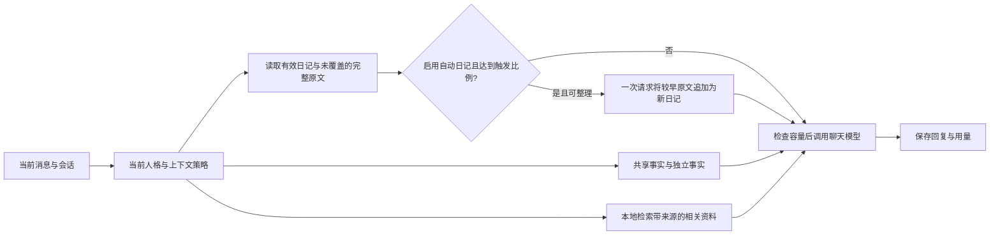

# WhaleLife 记忆系统

核对日期：2026-11-08。

本文说明完整上下文、逐篇日记、原文存储与插件边界。示例均为虚构数据，不包含本机配置或真实记忆。当前机制已完成集成验证；证据与未验证范围见[STATUS.md第6节](STATUS.md#6-现有验证与证据边界)。渠道接入见 [CHANNELS.md](CHANNELS.md)。

主干整体能力、实际调用链和统一问题表见 [STATUS.md](STATUS.md)。本文维护记忆的细节规则，不另维护主干待办；下文的预算管理仅指核心记忆整理和上下文预算，不管理插件额度。

统一会话队列只保存内存中的待执行请求，不属于记忆。等待、去重和执行前取消不会生成对话/经历或消耗模型token；真正执行时读取最新有效上下文，普通消息保留入队前的主干接收时间及来源。enqueueTransient沿用临时输入不落盘规则，工具结果与最终回复默认照常记录，显式临时工具按下述规则处理；等待项也阻止会话删除/记忆恢复等冲突操作。接口和容量/取消语义见[插件规范](PLUGINS.md#统一会话队列)。

聊天是主要记忆，工具执行过程是工作记录。普通Web/渠道聊天及sessions.run/ enqueue保留用户输入和最终助手正文，包括提问、约定和实际讲给用户的引用；调用临时工具不再把整条回复替换成占位文字。工具原始资料仍只供本轮执行，registerTransient的content不自动落盘，后续工具参数和检索query继续隔离，独立事实写入仍受保护。渠道保存最终聊天正文，显式重试只重投递，不重跑模型或工具。

工具自动投影标记为tool_trace，仅供审计，不进入日常记忆列表、检索、共享空间召回或后续上下文。真实业务结果继续通过已有recordExperience保存短经历；工具调用返回不代表业务成功，主干不解释插件的私有回执字段。已在聊天中表达的结果不再自动复制成一份可召回的工具过程。后台动作没有对应聊天时，插件仍应记录有依据的结果、来源及outcome。

执行档案独立保存在`logs/executions/<sessionId>/<executionId>.jsonl`，不在记忆目录，不参与检索、共享、摘要、认知或自动上下文组装。模型遇到异常、需要核对旧动作时可以自行调用只读工具`inspect_execution`，无需用户先问；只读取当前会话的选定分页。读取结果使用临时工具契约，仅留在当前任务上下文，下一次聊天不携带；最终对用户说出的排查结论属于正常对话。档案不会额外调用模型总结。记录内容和隐私边界见[插件规范的执行档案](PLUGINS.md#执行轮次与按需排查档案)。

旧工具自动投影只有与原始工具档案的来源、结果及完整投影文本相匹配才退出召回，不按关键词批量删记忆；无法匹配的旧记录保留。旧的临时占位消息从对话上下文和召回中排除，但原始档案不改写，已经没有保存的回复无法还原。显式runTransient/enqueueTransient属于插件技术执行，其临时输入不变；若该执行又使用临时工具，最终正文仍不自动成为聊天记忆，按既有契约留审计标记及用量。插件显式写文件或发送内容仍须负责真实结果和保存边界。字段和限制见[临时工具契约](PLUGINS.md#临时工具内容与持久回执)。

## 设计目标

WhaleLife 将会话视为持续存在的记忆空间。人格决定当前如何回应，会话保存共同经历；切换人格不创建新会话。不同会话默认独立，原有共享事实继续可用，跨会话分享必须显式选择。

核心提供经历、事实、完整上下文、逐篇日记、检索和自身整理用量管理。记忆只有一种机制，自动日记是可选开关；旧摘要与认知数据及接口保留兼容，当前机制不运行旧认知提炼。插件可以扩展业务记忆，意图与自主行动由自主性插件负责：安装一个能力不等于核心会主动执行它。

意图文件由主干通过通用会话文档接口托管；内容结构、产生、注入、唤醒、执行及结束处理均归自主性插件。没有自主性插件就不产生意图，也没有额外的主干意图工具或提示词。普通自主行动不以已有意图为前提。

磁盘保留完整档案。上下文始终由当前历史范围内的有效日记和未被覆盖的完整原文衔接；没有日记时即为完整有效对话。自动日记开关只决定今后是否生成新日记，实际发送的内容和整理请求决定用量，文件数量本身不会产生模型费用。

插件可用sessions.runTransient提供仅本轮有效的技术说明。输入及该轮检索query不落入记忆；真实决定和动作结果仍由recordExperience记录，普通会话不变。旧输入可通过excludeInputs按所属插件的精确消息ID排除，原文留作档案；详见PLUGINS.md的迁移契约。日记按来源记录及版本校验，仅失效实际引用了变化来源的日记；失效日记退出上下文，对应有效原文重新可用。旧摘要和自动认知沿用原有排除兼容规则，不通过正文替换猜测内容。

模型协议的reasoning_content仅在当前工具链内传递，不追加为经历、事实或认知，不写入未来历史。需要该协议的思考工具模型读取已完成历史时，以带原发言角色和来源的引用形式提供，保留现有窗口内的正文，不伪造缺失的旧思考字段。临时输入的wire角色用于开启新轮次，不是“真人发言”的存储标记。详见PLUGINS.md。

默认记忆列表合并当前会话与显式共享来源后，按记录时间ts从新到旧统一排序，再取100条。相同时间按session、id字典序稳定排序；缺失/无效时间放在有时间记录之后，同样按session、id排序，不用事件发生时间occurred_at替代ts。关键词查询仍按相关性排序；排序不改写原始内容。

## 内容与存储

| 内容 | 用途 | 写入边界 |
| --- | --- | --- |
| 原始经历 | 记录说过什么、做过什么、执行结果及来源 | 追加保存，不因摘要、修订或淡忘改写原文 |
| 共享事实 | 用户维护的共同资料 | AI 只读 |
| 独立事实 | 当前会话的少量稳定资料 | AI 可追加、替换或清空，整份正文硬上限 100 个 Unicode 码点 |
| 日记 | 容量达到阈值后，以第一人称保留较早交流的经历与理解 | 逐篇追加；每篇绑定固定原文 ID、顺序和版本，不反复总结已有日记 |
| 旧短期摘要与长期概览 | 兼容历史保存内容 | 当前机制仅供查看，不自动注入；旧内部 `legacy` 调用保留原语义 |
| 旧认知 | 兼容已有判断、证据、修订和复核数据 | 当前机制不调用旧认知生成或维护；已有查询与管理接口保留 |
| 插件扩展 | 插件私有状态及可检索的简短描述 | 按所属插件隔离、注册类型后使用 |
| 会话文档 | 插件自行解释的 JSON 文件，例如意图文件 | 公开接口读写，不参与召回、摘要或自动上下文注入 |

独立事实是常驻背景，不是待办或持续行动指令。主干提示模型优先保留称呼、长期偏好等稳定资料，一次活动和当日安排留在普通经历中；已有临时信息只描述记录当时的情况，不能因为没有更新就推断尚未完成。只在相关时使用，没有新信息或新约定不因同一事实反复询问、确认或催促，尊重用户不想被提醒的意愿。此处是提示词引导，不是提醒频率调度或强制语义过滤；不自动删除既有事实、不阻止用户明确保留内容，100字符限制和插件接口保持不变。

100 字限制只适用于独立事实整份正文，不是每条记录 100 字，也不是全部会话记忆只能有 100 字。空格、标点、换行均计数；后端写入、并发合计和备份恢复都校验。`full` 工具权限不能绕过这条规则，也不能让 AI 修改共享事实。独立事实保存最近 20 个历史版本。

```text
memory/
  facts.md                           用户维护的共享事实
  index.json                         当前会话选择、会话索引、摘要归属与删除墓碑
  sessions/<session-id>/
    session.json                     会话元数据的展示副本
    episodes/YYYY-MM.jsonl           分段原始流水，包含稳定事件 ID
    episodes/legacy.jsonl            迁移的旧流水（存在时）
    knowledge/state.json             独立事实、日记及来源版本、暂停状态、旧认知/摘要、预算和用量
    summaries/<summary-id>.md         旧摘要展示副本
    extensions/<owner-hash>/*.json    按需创建的插件私有数据
    extensions/<owner-hash>/documents/<key>.json  不参与检索的会话文档；intents 是插件可选的文件名
  shared/spaces.json                  显式共享空间与记录引用
  trash/                             删除会话后的可恢复档案
```

`index.json` 是会话元数据及当前会话选择的读取依据；`knowledge/state.json` 是日记、旧摘要/认知和整理状态的提交依据。每篇日记保存 `version`、独立 `id`、`session`、`scope`、`source_ids`、`source_revision`、`created_at` 和原文 `time_range`。来源版本只覆盖该篇引用的有序原文，追加无关新消息不会使旧日记失效。提交前重新检查原文版本及覆盖范围，重复来源不会生成第二篇有效日记。

原始流水、已保存日记、旧摘要和认知都不因开关自动日记而删除。旧摘要的 `short` / `long` 检查点及 `s_` / `p_` 键继续可读，展示副本不是第二份独立事实源；控制台保留查看状态和正文。开关自动日记不会把旧摘要悄悄加入模型，也不会改写已有会话 ID 或当前会话指针。

## 时间上下文

主干配置 `timezone` 默认 `Asia/Shanghai`。控制台暂时隐藏时区编辑入口，“使用配置 → 时间与日期”仅显示当前时间，保留已有配置及其保存兼容性。状态页接口返回主干系统时钟的时间、星期、时区及UTC偏移；显示的是读取时的快照，不调用外部授时服务。

完整会话链路每次请求模型都附加一行当前时间、本条消息时间和距本会话上次交流的间隔，包括工具执行后的继续请求。交流间隔仅使用当前历史权限可见的对话消息，不计工具、回执和后台整理；历史关闭或时间缺失时标记未知，未来时间标记异常。直接 `llm.chat` 及非对话模型接口保持原样。

新消息的 `ts` 保持UTC格式，同时保存当轮 `timezone`。历史输入按同一分钟、同来源合并标签，裁剪后首条恢复标签；模型输入预算计入标签和时间提示。修改工作空间时区不改变旧消息的原时区。旧记录缺少原时区时只作当前时区换算，并明确标注缺失，不猜相对日期。

记录时间与事情发生时间分开：插件 `recordExperience` 可选传入 `occurred_at`（必须是带时区的有效ISO时间，保存为UTC）；`ts`仍为主干实际记录时间。事件时间只作资料，不覆盖主干时钟，也不改变召回衰减规则。

日记接收原消息时间及对应当地时间，要求将有依据的“明天”等约定写成明确日期；无依据则保留不确定性。`time_range` 由原文计算，`created_at` 仅表示写日记的时间，不能冒充经历发生日期。旧摘要和认知已有的时间依据继续可读，缺失信息不猜测补全。日期理解仍由模型完成，来源元数据由代码校验。

时间信息不写入100字独立事实，不另起授时或总结请求。动态时钟位于稳定系统提示之后，每轮仅替换这部分，原始对话文本保留。基础时间行为测试见 `tests/time-context.test.ts`。

## 自动日记与触发

新样例默认 `diary_enabled: false`，即不自动生成日记。记忆始终使用有效日记与未覆盖的完整原文；尚无日记时保留当前范围的完整有效对话。不生成旧短期摘要、长期概览或新认知，也不使用旧的6000 token历史预算裁尾。达到已知模型容量时明确提示，保留原文，由用户调整模型、启用自动日记或显式新建会话；主干不自动切换当前会话。

设置 `diary_enabled: true` 后，只有当前上下文达到容量触发比例，才选取尚未覆盖的较早完整交流，将原文整理为一篇新的第一人称日记。本轮新输入始终保留。已有日记不作为下次总结材料；关闭自动日记仅停止今后的生成，已有有效日记仍替代覆盖的原文，不将全部旧原文重新灌入上下文。日期和消息条数都不是触发器，不再按7天或100条划分短期、长期。

`compression_trigger_percent` 默认80，`compression_target_percent` 默认50，目标须低于触发比例；两者可在控制台修改后保存。触发和目标均按“预计输入 token + 输出预留”占模型总上下文容量的比例计算，与界面预计占比同口径。目标比例是规划值，不承诺模型生成后恰好等于该百分比。容量未知时不自动触发日记；在模型服务中自动获取容量，服务未返回时可手动填写，手动值优先。只接受服务明确提供的上下文元数据，不根据模型名称猜测，也不把输出 token 上限当作上下文总容量。

`history_enabled` 继续控制是否带入历史，关闭时日记和原文均不带入；`history_scope` 控制会话或当前人格版本范围。自动日记开关不控制已保存日记的使用，也不会注入旧短期摘要、长期概览或运行旧认知整理。修改开关不删除原始资料，不改变 `current_session`。

旧 `memory_mode: "full" / "diary"` 保留为自动日记关闭/开启的兼容别名，新客户端使用 `diary_enabled`。显式新开关优先于同一配置中的旧字段。内部 `legacy` 仅承接未声明新开关、却显式携带旧模式或旧 `recent_lines`、`budget_tokens`、`include_summary`、`long_term_enabled`、`short_term_days`、`short_term_min_messages` 的既有调用；它不是界面选项。旧时间窗口、消息保底与整理调度仅属于该兼容路径。迁移现有配置须明确保存 `diary_enabled`，不能仅靠更改样例配置声称已迁移。

## 一轮对话如何使用记忆



默认 `history_scope=session`，同一会话内不同人格共用历史。显式选择 `persona` 时，只使用当前人格版本可见的历史；日记也须属于相同范围并通过来源校验。独立事实仍属于会话，不属于人格。

本地检索使用中文分词、少量别名、词稀有度和鲜活度排序；普通自动召回最多 6 条，默认约 800 估算 token。只截取相关原文附近片段，不把整个目录或所有历史版本发给模型。模型可使用 `recall_memory` 主动查找旧事，但仍受范围与结果预算限制。

普通经历默认按 30 天半衰期降低召回排序，不物理删除。置顶可以抵抗时间降权；明确追问历史时不使用时间降权。相关性不足时返回空结果。Embedding 配置与接口测试已存在，但当前记忆检索不调用 Embedding。

## 旧认知数据的兼容管理

本节说明保留的旧数据及接口语义，仅内部 `legacy` 整理路径会自动生成或修订这些认知；当前机制不运行它。新日记只生成日记正文，不额外创建认知条目、事实、计划或意图。

在旧兼容路径中，例如旧认知为“用户居住南京”，新经历明确说明“已经搬到北京”。当新经历进入长期范围并达到整理条件时，核心取出相关旧认知，允许模型产生“用户居住北京”，同时引用新经历并指定替代的旧认知。旧记录保留原文和原证据，退出普通召回；短期压缩不会触发这种修订。

认知状态如下：

| 状态 | 含义 | 普通召回 |
| --- | --- | --- |
| `active` | 当前有效的判断，仍可能带不确定性 | 可参与 |
| `review` | 新材料使旧判断存疑，尚无可靠替代 | 不参与 |
| `superseded` | 已有后续认知替代它 | 不参与 |
| `archived` | 用户归档，或该修订已被用户撤回 | 不参与 |

有效不等于客观真理。`uncertain` 表达判断的不确定性，老记录缺少此字段时按不确定处理；它会随认知片段提供给模型。保留来源 ID 只能证明资料存在，不能自动证明判断正确。

整理过程遵循以下规则：

1. 只筛选本会话相关且未归档、未被替代的认知，最多 4 条，总候选预算不超过约 800 估算 token。共享空间中的其他会话认知不会成为可修改目标。
2. 新增或修订认知最多 2 条，每条不超过 80 个 Unicode 码点；待复核标记最多 2 条。替代、合并和复核必须引用本批新增经历，并填写不超过 100 字的依据。
3. 明确纠正或等义合并才替代；不确定的矛盾标记待复核。模型提示要求保留仍有效的信息，不能把助手自己说的话当作用户事实。
4. 后端校验目标属于候选集合、证据属于本批原文、目标仍是同一版本。目标被用户归档、修改或已被其他修订替代时，整批拒绝，不部分提交。
5. 新认知通过 `supersedes` 引用旧记录，旧记录通过 `superseded_by` 指向替代记录。合并可以关联多个前身，置顶状态随替代继承。
6. 同人格版本下完全相同的有效认知不重复增加记录，只合并有限数量的证据引用。语义相近但文字不同的合并由同一次整理判断。
7. 认知变更、长期概览与长期处理游标原子提交；失败不推进游标。相同成功批次重放不会重复创建认知。短期摘要使用单独进度，不会让长期整理漏掉曾被短期压缩的原文。

控制台“记忆检索”勾选“包含已归档、已替代与待复核”可以查看旧记录及修订依据。待复核记录可由用户确认有效；最新的认知修订可撤回，恢复其直接前身。已有后续修订时必须从最新一层向前撤回，不能直接复活一个旧版本并让矛盾版本同时有效。撤回仅调整认知状态，不倒改聊天原文或已经生成的历史摘要。

模型整理不能修改共享事实，也不通过认知修订偷偷更新独立事实。独立事实仍由专门的 `remember_fact` / `edit_facts` 工具遵守 100 字限制。

## 控制调用成本

| 项目 | 当前默认或上限 |
| --- | --- |
| 自动日记关闭 | 不产生自动整理请求；继续使用已有有效日记与未覆盖原文，超过已知容量时明确提示 |
| 日记触发 | 预计输入加输出预留达到模型容量的80%；可配置，按50%目标选取较早完整原文 |
| 整理频率 | 每次触发至多一次日记生成请求，不循环重写、不递归总结旧日记，不在空闲时运行 |
| 日记内容 | 长度随材料复杂度确定，不套200字或2条认知模板；每次请求仍有有限输出额度，存储校验上限32000个Unicode码点 |
| 每日额度 | 核心记忆整理沿用每会话默认20,000 token额度，按UTC日期重置；可配置0–10,000,000，设为0停止后续自动整理。升级不提高已有额度；额度不足不拆成反复请求 |
| 失败处理 | 原文和成功日记保留；非取消失败暂停当前历史范围，需显式恢复后再按阈值尝试，不随聊天反复自动重试 |

日记请求只包含本批原始记录及写作说明，保留时间、来源、用户陈述、助手行动、已证实结果与不确定理解的区别。已有日记正文不会再次送入日记生成请求。完整性、来源版本及节省容量校验均通过后才提交；截断、无效JSON、异常结束或没有节省容量时不提交新日记，也不丢弃原文。

调用前预留完整请求的估算输入加最大输出；超过已知模型窗口或当天整理额度时保留原文并提示。同一天收到有效用量后按实际输入加输出结算并退回多余预留，明确未发出的请求可释放预留；失败但有有效用量仍计入记忆统计，未知用量保守保留预留。跨日完成不退还新一天额度，进程中断不释放可能已消耗的额度。取消不新增日记失败暂停。每日额度只管理核心整理，不代替服务商账单。

日记使用当前模型的独立请求参数副本，不修改已保存配置或普通聊天。已识别的DeepSeek接口在日记请求中关闭思考并要求JSON；其他模型保留自己的参数。思考正文不保存为记忆。旧短期/长期的输出上限、轮流调度和递增退避仅留在内部 `legacy` 路径，不叠加到当前机制。

控制台主要显示根据最新有效材料组装得到的**预计上下文占比**：预计输入加输出预留除以模型总容量；它在每轮后更新，也反映当前模型、人格、记忆模式和资料的变化。**上次请求实际用量**另列服务返回的输入与输出之和，不能冒充下一轮精确值。聊天累计和记忆整理累计继续分账；未知容量或用量保持未知，不显示虚假的0%。文字token估算和图片计量仍有误差，只有服务返回的usage是该次请求的实际统计。

插件调用的频率、是否限额及超额处理由插件决定，不属于主干预算管理。未来插件用量上报只用于汇总展示；上文的记忆整理预算仍只管理核心自身的整理任务。

## 插件与渠道边界

每条经历可带 `origin`：`plugin` 表示实际插件归属，`channel` 表示渠道标识，`platform` 是显示名，`action` 是动作描述。渠道自动记录来源并区分接收消息、生成回复和已确认发送。工具来源由注册它的插件绑定；工具调用完成仍不等于业务成功，插件需要记录真实结果。

插件可在 `ctx.tools.register`、`ctx.memory.recordExperience`、`ctx.memory.saveExtension` 的输入里声明 `origin: { platform: '轨道视频', action: '读取字幕' }`。平台名最多32码点、动作最多48码点且不得含控制字符；`plugin` 由核心填写，插件接口不接受冒充其他归属的字段。核心没有平台/动作白名单，新插件声明通用元数据即可，不修改主干。具体平台接入与业务逻辑始终属于插件；新增共性能力应通过向后兼容的通用契约演进，不在主干堆平台特例。

当前来源进入系统上下文；历史消息只在来源发生变化时加标签，裁剪后重新为保留的第一条消息标注来源。召回与 `recall_memory` 返回来源、动作、实际结果，平台名称也可作为检索词。账号、peer、发送者等路由标识仍保存在原始记录，不逐条灌入模型。

日记生成输入保留原文来源，提示要求区分用户陈述、外部资料和助手行动；日记通过固定原文ID、版本及时间范围追溯依据。旧摘要的去重来源列表、认知证据引用和 `origins_incomplete` 标记继续可读，但不能将汇总来源误解为每句话的精确归属。旧记录缺失的平台或插件归属不猜测补全。新增来源元数据计入输入估算，独立事实100字限制和费用分账不变。

- 插件通过 `ctx.memory.recordExperience()` 保存实际业务经历，必须区分提交、成功、失败和拒绝；重复事件用稳定 ID 去重。核心工具调用完成不等于外部业务已完成。
- 插件可注册自己的记忆类型、保存私有状态与简短检索描述。停用后不再自动召回其活跃扩展，但已经发生的通用经历与私有数据保留。
- 通用渠道解决消息格式、会话绑定和回传，让平台复用相同的人格、记忆和用量流程。它不实现 QQ、微信等平台协议。
- 认知修订归本体，插件不能通过记忆门面任意改写核心认知或其他插件状态；安装插件独立执行但仍属于受信任代码，并非操作系统安全沙箱。
- 不安装自主性插件就没有意图生成或自主行动循环。意图使用不参与召回的会话文档，首次保存才创建文件；不要用带检索描述的扩展记录冒充已经发生的意图执行经历。文件内容的格式和迁移属于插件。

### 不参与召回的会话文档

`ctx.memory.readDocument(sessionId, key)` 返回 `{revision, data}`；文件不存在时二者均为 `null`，读取不会创建文件。`ctx.memory.saveDocument(sessionId, {key, revision, data})` 原子替换整份文档并返回新快照。必须使用最近读取的 revision；首次创建传 null。冲突会拒绝保存，插件应重读并根据业务合并，不能盲目覆盖。保存 null 是清空内容，文件及其新 revision 仍保留。

key 为1–64个小写字母、数字、下划线或连字符，以字母开头。data 为 JSON 数据，序列化后的UTF-8正文最多256 KiB；这是文件大小限制，不是注入模型的 token 预算。主干不校验意图内容、不自动提炼或删减。不同会话、不同插件的数据隔离，插件ID由主干绑定；无需 registerType。会话必须存在且未删除。插件停用/故障后旧入口不可使用，已排队但未提交的写入会取消；已提交数据保留，同ID插件可恢复读取。

文档随现有会话备份、恢复和删除归档一起处理；不会独立产生记忆事件、检索结果、用量或工具。需要业务通知时由插件在成功保存后发自己的事件，恢复状态不能只依赖通知。文件原子替换和 revision 防止部分写入、并发覆盖，不等于与 recordExperience 或外部动作组成跨接口事务；这类业务关联、重试和幂等由插件通过自身记录设计。普通历史经历仍走 recordExperience。

共享空间保存记录引用而非复制所有会话。加入空间不会自动发布记忆；只有用户明确分享的记录才能被其他成员检索。已分享旧认知被替代后退出普通召回，新认知不会自动继承分享授权，需另行分享。

## 已知边界与后续方向

- 当前是本地文字召回。完全不同措辞可能找不到相关旧认知，因而漏掉矛盾；本轮不宣称完整语义检索或自动事实核查。
- 日记只按容量阈值触发。未知容量、整理暂停、额度不足、没有可安全整理的完整旧交流或日记仍无法缓解容量时，都保留原文并提示；不会通过追加调用、悄悄裁尾或切换会话兜底。
- 目标百分比是估算目标，不能保证每篇日记的语义完整或压后恰好达到目标。原文保留及来源校验提供核对依据，不构成自动事实核查。
- 暂未建立跨认知的通用依赖图，也不会对全部历史执行全面矛盾扫描。证据引用、修订关系和待复核状态是当前维护基础。
- 原始历史依然可能包含过时陈述；提示要求区分历史与现在，不会为了得到整齐答案而篡改原文。
- 插件经历已可检索；日记批次读取有效对话原文，不自动把插件私有数据与所有业务经历送模型提炼。
- 索引可以重建，不能将人工改 JSON 文件视为受支持的编辑接口。备份恢复会检查状态结构、长度和认知关系。

向量召回及上下文缓存业务尚未实现，也没有本轮新增的提供者注册接口。原文稳定ID、日记schema、固定来源版本及已有公开记忆/模型接口是后续可扩展的边界；实现这些业务时再明确插件契约，不把内部文件或主干私有对象当接入点。

## 源码入口与验证

| 文件 | 职责 |
| --- | --- |
| `core/memory.ts` | 原文存储、会话元数据、迁移与写入队列 |
| `core/memory-engine.ts` | 事实、候选筛选、召回、预算、原子整理提交、插件门面 |
| `core/cognition.ts` | 修订校验、替代、复核、重复合并和用户撤回 |
| `core/provenance.ts` | 通用来源校验、来源汇总与精简的历史标注 |
| `core/session.ts` | 上下文组装、模型调用与用量记录 |
| `core/session-context.ts` | 当前机制策略、容量比例及旧字段兼容 |
| `core/context-material.ts` | 完整历史/日记材料组装与完整旧交流选材 |
| `core/model-context.ts` | 服务容量解析、手动优先及连接配置缓存隔离 |
| `core/memory-diary.ts`、`core/memory-diary-state.ts` | 逐篇日记、固定来源版本、原子提交校验及失败暂停 |
| `core/memory-lifecycle.ts` | 内部legacy短期/长期整理兼容 |
| `core/memory-tools.ts` | AI 可调用的有限记忆工具 |
| `core/memory-admin.ts` | 备份、恢复、档案管理 |
| `core/ui/memory.js` | 记忆控制台 |

自动日记开关校正已通过44项相关专项及类型检查；本轮未重跑全量测试。此前逐篇日记实现的509项全量测试和两次真实模型隔离合成验收保留为历史证据，不能冒充本轮检查。最新兼容检查与部署边界统一维护在[STATUS.md第6节](STATUS.md#6-现有验证与证据边界)。仓库回归使用临时目录和模拟模型，不调用真实供应商、不写正式记忆，不将本机凭据或私人资料加入仓库。Node.js 24 环境下，相关专项可执行：

```sh
node --test tests/diary-context.test.ts tests/diary-engine.test.ts tests/diary-console.test.ts tests/diary-web.test.ts tests/model-capacity.test.ts
node --test tests/cognition.test.ts tests/memory-engine.test.ts tests/memory-lifecycle.test.ts tests/memory-v2-integration.test.ts tests/memory-v2-resilience.test.ts tests/memory-v2-ui.test.ts tests/memory-v2-web.test.ts tests/temporal-memory-ui.test.ts
node --test tests/memory-summary-recovery.test.ts tests/memory-summary-status.test.ts tests/memory-budget-settlement.test.ts tests/memory-generation.test.ts
node node_modules/typescript/bin/tsc --noEmit
```

以上旧专项覆盖认知维护原子性、范围与证据校验、并发候选失效、撤回、重复整理、预算、会话流程及控制台兼容；不能替代自动日记专项，也不代表已经完成长期真实对话的语义效果评测。

旧版整理的实际模型验收脚本为 `node tests/memory-lifecycle.live.mjs --run`，普通测试不会触发它，也不作为自动日记的验收入口。它读取当前已选模型的连接配置，在临时目录使用虚构人格、事实和会话，最多调用6次、预估输入加输出上限16000 token，不修改正式配置或记忆。覆盖旧短期压缩、长期认知纠正、重建/切人格、后续回答、跨会话隔离和实际用量分账。结果保存至被Git忽略的 `.artifacts/temporal-memory-live-acceptance.json`；临时档案保留供检查。少量样例通过不等于长期语义质量的全面保证。
